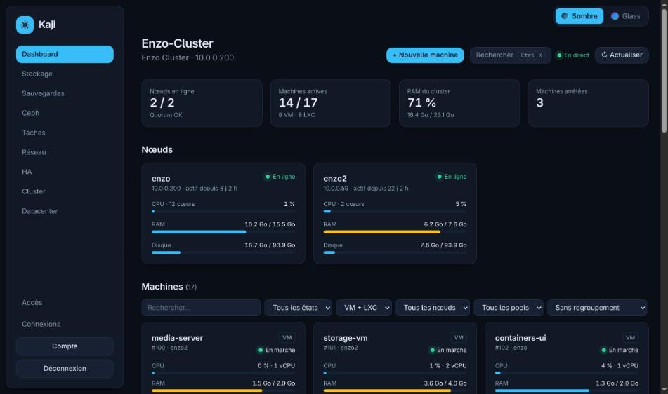

# Kaji

Le gouvernail de ton homelab (« kaji » signifie gouvernail en japonais). Interface web moderne pour piloter un cluster Proxmox VE : supervision, création et gestion des VM/LXC, et paramétrage du cluster (stockage, sauvegardes, utilisateurs, réseau, firewall, HA).

**Statut : candidat V1.** Les fonctions sont classées en « validé en réel », « expérimental » et « limites connues » dans [docs/statut-fonctions.md](docs/statut-fonctions.md) ; la revue de sécurité est dans [docs/securite.md](docs/securite.md) ; la feuille de route complète est dans [PLAN.md](PLAN.md).

## Installer Kaji en 15 minutes
> Pour un lab : réseau local ou VPN, **jamais exposé sur Internet**. Guide complet pas à pas, avec le dépannage : [docs/installation-lab.md](docs/installation-lab.md).

**1. Sur un nœud Proxmox, en root : créer Kaji** (conteneur Debian, Docker et Kaji installés pour toi). Télécharge, relis, lance :
```bash
curl -fsSL https://raw.githubusercontent.com/Ek8Oxilive/kaji/main/tools/proxmox-create-ct.sh -o proxmox-create-ct.sh
less proxmox-create-ct.sh        # relis-le
sh proxmox-create-ct.sh          # demande confirmation ; --dry-run pour voir sans rien faire
```
À la fin, il affiche **l'adresse de Kaji et un jeton de première configuration** : note-les. *(Tu as déjà une machine Linux avec Docker ? Même chose avec [`install.sh`](install.sh).)*

**2. Sur un nœud Proxmox, en root : créer le compte et le jeton de Kaji** (lecture seule, privilèges séparés, expiration) :
```bash
curl -fsSL https://raw.githubusercontent.com/Ek8Oxilive/kaji/main/tools/proxmox-setup.sh -o proxmox-setup.sh
less proxmox-setup.sh && sh proxmox-setup.sh
```
Le **secret du jeton s'affiche une seule fois** : copie-le tout de suite.

**3. Sur ton poste : ouvrir Kaji.** Récupère le certificat avec `pct pull <identifiant> /root/kaji/caddy-root.crt caddy-root.crt` (sur le nœud) et copie-le sur ton poste, puis installe-le comme autorité de confiance ([comment faire](docs/installation-lab.md) § 5), ouvre `https://<adresse de Kaji>`, crée le compte administrateur avec le jeton de l'étape 1.

**4. Page « Connexions » : brancher Proxmox.** Un guide en 3 étapes s'ouvre tout seul : « Pré-remplir », colle le secret de l'étape 2, « Tester », « Enregistrer », puis « Épingler le certificat » (compare l'empreinte avec celle du script).

**Ensuite** : donne à Kaji les droits dont tu as besoin depuis la page « Accès » (elle affiche les commandes à copier, jamais `Administrator`) et **sauvegarde `/root/kaji/.env`** à part : sans sa clé, la base est inutilisable.

**Sommaire** : [Fonctionnement](#fonctionnement) · [Interface web](#interface-web) · [Captures d'écran](#captures-décran) · [Déploiement](#déploiement) · [Configuration](#configuration-env) · [Durcissement](#durcissement) · [Tests](#tests) · [Contribuer](#contribuer)

## Ce que fait Kaji
Kaji est une interface web moderne pour piloter un cluster Proxmox VE. Il ne remplace pas Proxmox : il parle à son API avec un jeton.

- **Voir** : tableau de bord en temps réel (nœuds, machines, stockage, tâches), recherche, filtres et palette de commandes (Ctrl+K).
- **Gérer les machines** : démarrer, éteindre, créer (assistants VM et conteneur), cloner, migrer, snapshots, disques, réseau, Cloud-init, consoles.
- **Configurer le cluster** : stockage, sauvegardes, réseau et pare-feu, HA et réplication, Ceph, utilisateurs et droits, système des nœuds.
- **Propre à Kaji** : actions planifiées, alertes (avec webhook), journal d'audit, plusieurs utilisateurs avec des rôles.
- **Confort** : quatre thèmes (Sombre, Glass, Clair, Auto), français et anglais, utilisable sur petit écran.



→ [Toutes les pages en images](docs/captures.md) · [Le détail des fonctions](docs/fonctions-interface.md) · [L'état de chaque fonction : validée en réel, expérimentale…](docs/statut-fonctions.md)

## Comment ça marche
- **Premier lancement** : tu crées le compte administrateur (mot de passe de 12 caractères au moins, et le jeton de première configuration).
- **Clusters** : ils s'ajoutent depuis l'interface (hôte, utilisateur, jeton API), rien dans un fichier. Les jetons sont stockés **chiffrés** ; les mots de passe sont hachés (argon2id) ; la session est un cookie `HttpOnly` et `SameSite=Strict`.
- **Trois rôles** : `admin` (tout), `operator` (lire, démarrer, arrêter, redémarrer, créer un snapshot), `viewer` (lecture seule). Le serveur les applique à chaque requête ([détail](docs/api/roles-kaji.md)). Ils protègent l'accès à Kaji ; auprès de Proxmox, Kaji agit avec son jeton, ou avec le jeton personnel de chacun si tu l'actives ([détail](docs/api/jetons-utilisateur.md)).
- **Bouton « Compte »** : changer son mot de passe, déconnecter toutes ses sessions et, pour un administrateur, gérer les utilisateurs.
- **Actions planifiées et alertes** : elles tournent dans le processus de Kaji, donc **une seule instance à la fois** (`KAJI_SCHEDULER=false` les coupe ; [actions](docs/api/actions-planifiees.md), [alertes](docs/api/alertes.md)).
- **Droits et double authentification** : les écrire demande une « session administrateur » temporaire (30 minutes, en mémoire) ; le mot de passe n'est jamais gardé ([détail](docs/api/admin-session.md)).

> **Sécurité :** Kaji détient un jeton Proxmox. Ne l'expose pas sur Internet : réseau local ou VPN, derrière HTTPS. Crée le compte administrateur avant toute exposition réseau. Durcissement et protection des secrets : [docs/durcissement.md](docs/durcissement.md) ; mot de passe oublié : `python -m app.admin_cli reset-password --user <nom>` sur le serveur.

## Donner des droits à Kaji dans Proxmox
Côté Proxmox, crée l'utilisateur et le jeton avec `tools/proxmox-setup.sh` (lecture seule, **privilèges séparés**, expiration ; [docs/installation-lab.md](docs/installation-lab.md) § 2), puis saisis l'hôte, `kaji@pve`, l'ID `kaji` et le secret dans Kaji. Donne ensuite les droits fonction par fonction depuis la page « Accès » : évite `--privsep 0`, qui donnerait au jeton tous les droits de son compte.

Les actions (démarrer, snapshots…) demandent plus que la lecture seule : donne le rôle `PVEVMAdmin` au jeton **uniquement sur les machines concernées**, et garde `PVEAuditor` sur `/`. La page « Accès » de Kaji montre, fonction par fonction, ce qui manque, avec les commandes à copier.

## Configuration (`.env`)
Les variables principales ; la liste complète est dans [docs/installation-lab.md](docs/installation-lab.md) (§ 3.1) et dans `.env.example`.

| Variable | Rôle | Défaut |
|---|---|---|
| `KAJI_SECRET_KEY` | Chiffrement des tokens et signature des sessions. **Obligatoire**, à garder secrète. Si tu la perds, les connexions enregistrées sont à ressaisir. | – |
| `KAJI_COOKIE_SECURE` | Cookie de session en `Secure`. Mettre `false` seulement en HTTP sur le réseau local. | `true` |
| `KAJI_TRUST_PROXY` | Derrière un reverse proxy **de confiance** uniquement : le limiteur de connexions utilise l'IP ajoutée par le proxy (`X-Forwarded-For`). Sinon l'en-tête est ignoré, car falsifiable. | `false` |
| `KAJI_AUDIT_RETENTION_DAYS` | Durée de conservation de l'audit ; les entrées plus anciennes sont supprimées (0 = indéfiniment) | `365` |
| `KAJI_PROTECTED_VMIDS` | Identifiants de machines que Kaji refuse de supprimer, quoi qu'il arrive (ex. `105,108`). **Recommandé** pour tes machines importantes. | vide |
| `DATABASE_URL` | Base de données | `sqlite:///./kaji.db` |
| `KAJI_SESSION_HOURS` | Durée de session | `12` |
| `KAJI_SETUP_TOKEN` | Jeton de première configuration : tant qu'aucun compte n'existe, l'écran de création du compte administrateur l'exige (sinon le premier qui atteint le port le crée). **Recommandé.** | vide |
| `KAJI_ADMIN_USE_KAJI_TOKEN` | Ouvre la session administrateur d'un clic avec le jeton de Kaji, à qui tu as donné les droits d'administration dans Proxmox. **Désactivé par défaut** : activé, compromettre Kaji revient à compromettre l'administration de Proxmox (voir [docs/securite.md](docs/securite.md)). | `false` |
| `KAJI_SCHEDULER` | Lance le planificateur d'actions et l'évaluation des alertes dans le processus de Kaji. `false` les coupe. | `true` |

## Développer en local
**Pile technique** : FastAPI (Python 3.12) · SQLAlchemy / SQLite · React + Vite + Tailwind · Docker Compose (backend + nginx ; HTTPS Caddy en option).

Prérequis : Python 3.12+ et Node 20+.
```bash
git clone https://github.com/Ek8Oxilive/kaji.git && cd kaji
cp .env.example .env
python3 -c "import secrets; print(secrets.token_urlsafe(48))"   # colle le résultat dans KAJI_SECRET_KEY
cd backend
python3 -m venv .venv && .venv/bin/pip install -r requirements-dev.txt
.venv/bin/uvicorn app.main:app --reload       # API : http://127.0.0.1:8000/docs
.venv/bin/pytest                              # tests (dans un autre terminal)
```
Interface, dans un autre terminal : `cd frontend && npm install && npm run dev` (http://localhost:5173, les appels `/api` sont relayés vers le backend). Environ 360 routes : la liste est dans [docs/CARTE.md](docs/CARTE.md), un extrait dans [docs/api-extrait.md](docs/api-extrait.md), et chaque fonction a sa fiche dans [`docs/api/`](docs/api/).

## Contribuer
- Une branche par fonctionnalité (`feat/...`, `fix/...`), une PR par bloc cohérent, aucun commit direct sur `main`.
- Messages de commit en [Conventional Commits](https://www.conventionalcommits.org/), avec le **jalon** de [PLAN.md](PLAN.md) et la zone en scope : `type(Mx/zone): message`.
  - Exemples : `feat(M2/actions): démarrer et arrêter une VM`, `fix(M1/auth): expiration du cookie`, `docs(M0): précise le démarrage`.
  - Types : `feat`, `fix`, `docs`, `test`, `refactor`, `chore`, `ci`. Hors jalon (outillage, docs générales) : `chore(repo): ...`.
- Chaque PR est rattachée au **milestone GitHub** correspondant (M0 à M15).
- La CI (tests du backend, build du frontend, build des images Docker) doit être verte avant merge ; tout texte visible du frontend passe par `tr("…")` avec sa traduction (voir [docs/interface-langue.md](docs/interface-langue.md)).

## Documentation
| Pour… | Voir |
|---|---|
| Installer Kaji pas à pas, dépannage | [docs/installation-lab.md](docs/installation-lab.md) |
| Déployer, HTTPS, sauvegarde, mise à jour | [docs/deploiement.md](docs/deploiement.md), [docs/runbook.md](docs/runbook.md) |
| Savoir ce qui est validé en réel | [docs/statut-fonctions.md](docs/statut-fonctions.md) |
| Sécurité | [docs/securite.md](docs/securite.md), [docs/durcissement.md](docs/durcissement.md) |
| Voir l'interface | [docs/captures.md](docs/captures.md) |
| Suivre le projet | [PLAN.md](PLAN.md), [CHANGELOG.md](CHANGELOG.md) |

## Licence
[MIT](LICENSE)
